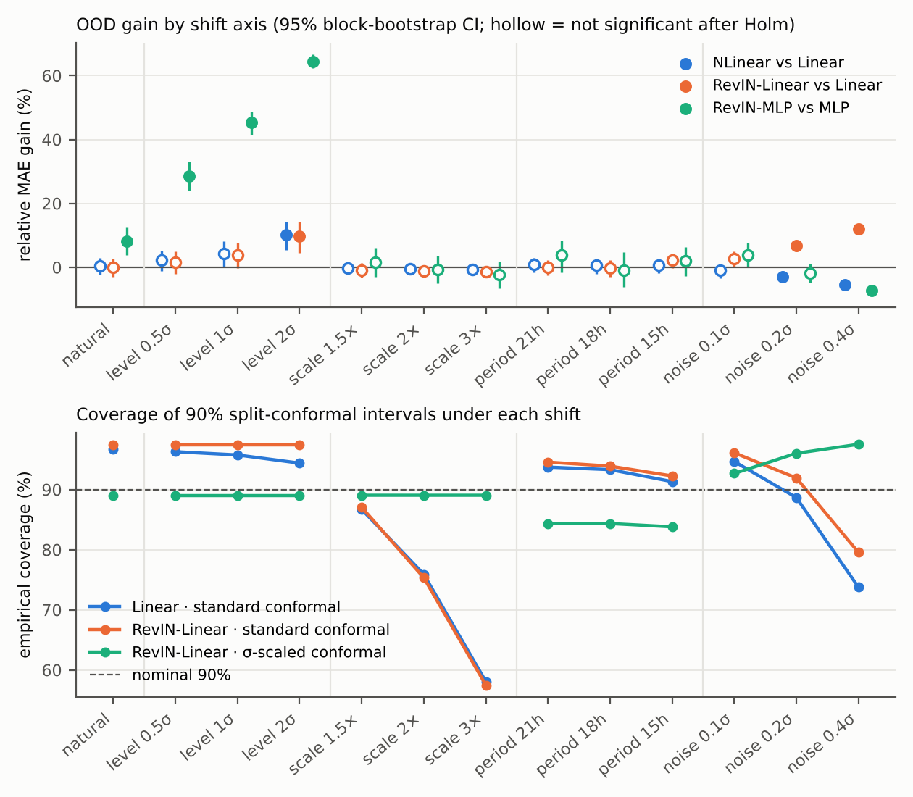

# TS-OOD-Pilot — does an "OOD gain" survive when shift types are separated?

A small, CPU-only pilot (under a minute, including the dataset download) on the public **ETTh1** benchmark. It evaluates two widely
used distribution-shift remedies for forecasting — last-value normalisation (**NLinear**) and reversible instance
normalisation (**RevIN**) — under four *separately controlled* shift axes, using statistics that suit forecasting
(Diebold–Mariano with HLN correction, Holm adjustment, moving-block bootstrap) and split-conformal uncertainty.

It is the starting point of a proposed Master's project on **shift-separable evaluation of time-series OOD
generalisation**, motivated by the open challenge on *uncertainty quantification and benchmark OOD evaluation*
identified in the TS-OOD survey by Wu, Teng *et al.*

## Key results (lookback 96 h → horizon 24 h, oil temperature, standard 12/4/4-month split)

| # | Finding |
|---|---|
| 1 | **Gains are axis-specific.** Under a 1σ level shift RevIN cuts the MLP's error by **45 %** (95 % CI 42–49 %). Under amplitude, period and mild noise shifts its gain stays between −2.4 % and +3.8 % (none significant after Holm), and under strong sensor noise it makes the MLP **7 % worse** (Holm-adjusted DM p < 0.05). |
| 2 | **The headline depends on the benchmark.** Averaging the per-axis gains over any subset of the four axes gives a "headline OOD gain" of **−2.9 % … +4.4 %** (NLinear), **−1.1 % … +6.8 %** (RevIN-Linear) and **−1.9 % … +45.2 %** (RevIN-MLP). The sign is a property of the benchmark, not only of the method. |
| 3 | **In-distribution validation cannot pick the OOD winner.** Ridge strengths within 1 % of the best validation MSE change RevIN-Linear's gain over Linear under 0.4σ sensor noise anywhere from **−32 % to +17 %**. |
| 4 | **Uncertainty fails differently from accuracy.** For RevIN-Linear, nominal 90 % conformal intervals cover 97 % on the natural test period but only **57 %** under a 3× amplitude shift. Scaling residuals by the window's σ restores ≈89 % under level and amplitude shifts but **not** under the period (concept-type) shift, where coverage stays at 82–84 %. |
| 5 | **Input-drift scores can mislead.** A moment-based drift score rates 0.4σ sensor noise as *closer* to the training data than the unmodified test period, while Linear's error under that noise is 97 % higher. |

## Design (shift axes and severities fixed before the first run; hyperparameters chosen on validation only)

* **Data:** ETTh1 oil temperature (univariate), z-scored with training statistics; windows with stride 1.
* **Conditions:** the unmodified test period plus four axes × three severities applied to it —
  LEVEL (+0.5/1/2 σ), SCALE (×1.5/2/3), PERIOD (daily cycle → 21/18/15 h by time-warping; the history→future mapping
  changes), NOISE (σ = 0.1/0.2/0.4 on inputs only, three noise draws).
* **Methods:** seasonal naive, ridge Linear, NLinear, RevIN-Linear (instance normalisation without affine), MLP and
  RevIN-MLP (three seeds each). Ridge strength is chosen on the validation period from 0.1–10⁴.
* **Inference:** Diebold–Mariano test with Harvey–Leybourne–Newbold correction and Newey–West variance (lag H−1),
  Holm correction over the 13 conditions, paired moving-block bootstrap CIs (block 2H; conclusions unchanged at 4H).
  McNemar's test is not used: forecast errors are continuous and overlapping windows are serially dependent.
* **Uncertainty:** split-conformal 90 % intervals calibrated on validation, standard and σ-scaled.

## Run it

* **Colab:** click the badge above, then *Runtime → Run all*. No GPU needed.
* **Locally:** `pip install -r requirements.txt`, then open `ts_ood_pilot.ipynb` and run all cells, or
  `jupyter nbconvert --to notebook --execute ts_ood_pilot.ipynb`.
* ETTh1 is downloaded at run time from the dataset authors' repository
  ([zhouhaoyi/ETDataset](https://github.com/zhouhaoyi/ETDataset)); offline, place `ETTh1.csv` next to the notebook.
  The dataset is not redistributed here; see that repository for its licence.

Outputs (figures, `results_table.csv`, `summary.json`) are written to `outputs/`.

## Limitations

One dataset, one target, one horizon; linear and small MLP models only; shifts are constructed rather than observed,
which buys control at the cost of external validity; the PERIOD axis is a controlled stand-in for concept shift; the
expanding-variate setting (Ma *et al.*, KDD 2025) is not covered yet. Bootstrap CIs are per condition; multiplicity is
handled by Holm on the DM tests.

## Next steps (the proposed project)

Multivariate ETT, Weather and Electricity at horizons 96–720; representative methods from the TS-OOD survey's
taxonomy; an expanding-variate axis; and a reporting checklist covering per-axis gains, severity curves,
hyperparameter sensitivity and coverage under shift.

## References

* X. Wu, F. Teng, X. Li, J. Zhang, T. Li, Q. Duan. *Out-of-Distribution Generalization in Time Series: A Survey.* Information Fusion, 2026. [arXiv:2503.13868](https://arxiv.org/abs/2503.13868)
* M. Ma, K. Tang, H. Li, F. Teng, D. Zhang, T. Li. *Beyond Fixed Variables: Expanding-variate Time Series Forecasting via Flat Scheme and Spatio-temporal Focal Learning.* KDD 2025. [arXiv:2502.15296](https://arxiv.org/abs/2502.15296)
* T. Kim *et al.* *Reversible Instance Normalization for Accurate Time-Series Forecasting against Distribution Shift.* ICLR 2022.
* A. Zeng, M. Chen, L. Zhang, Q. Xu. *Are Transformers Effective for Time Series Forecasting?* AAAI 2023.
* H. Zhou *et al.* *Informer: Beyond Efficient Transformer for Long Sequence Time-Series Forecasting.* AAAI 2021.
* F. X. Diebold, R. S. Mariano. *Comparing Predictive Accuracy.* J. Business & Economic Statistics, 1995.
* D. Harvey, S. Leybourne, P. Newbold. *Testing the Equality of Prediction Mean Squared Errors.* Int. J. Forecasting, 1997.
* H. R. Künsch. *The Jackknife and the Bootstrap for General Stationary Observations.* Annals of Statistics, 1989.
* J. Lei *et al.* *Distribution-Free Predictive Inference for Regression.* JASA, 2018.
* A. D'Amour *et al.* *Underspecification Presents Challenges for Credibility in Modern Machine Learning.* JMLR, 2022.

---
Ashhar Hussain · [ORCID 0009-0009-1568-9852](https://orcid.org/0009-0009-1568-9852) · asharhussain.csit@uokajk.edu.pk
